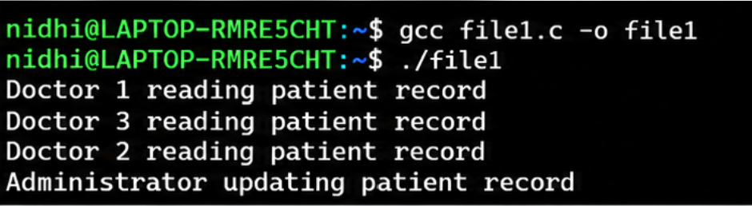

# semaphore

# Experiment 5: Reader-Writer Problem

## Aim
To implement and study the Reader-Writer problem using C programming.

## Description
The Reader-Writer problem is a process synchronization problem in operating systems. Multiple readers can read shared data simultaneously, but a writer requires exclusive access to modify the data.

This experiment demonstrates synchronization using semaphores and mutexes to protect shared resources.

## Program

**File:** `experiment5_reader_writer.c`

## Output

**Output Image:** `experiment5_reader_writer_output.png`



## Requirements
- C compiler (GCC)
- POSIX threads (`pthread`)
- POSIX semaphores

## How to Compile and Run

Compile the program:

```bash
gcc experiment5_reader_writer.c -o reader_writer -pthread
```

Run the program:

```bash
./reader_writer
```

## Concepts Covered
- Process synchronization
- Multithreading
- Readers and writers
- Critical sections
- Mutual exclusion
- Semaphores and mutexes
- Race condition prevention

## Real-World Application
In a hospital information system, multiple doctors may read patient records simultaneously, while an administrator updates those records. Synchronization ensures that readers do not access the shared data while it is being modified.

The same concept is useful in banking systems, library databases, and other applications involving shared data.

## Result
The Reader-Writer problem demonstrates how synchronization mechanisms coordinate concurrent readers and writers while protecting shared resources.
